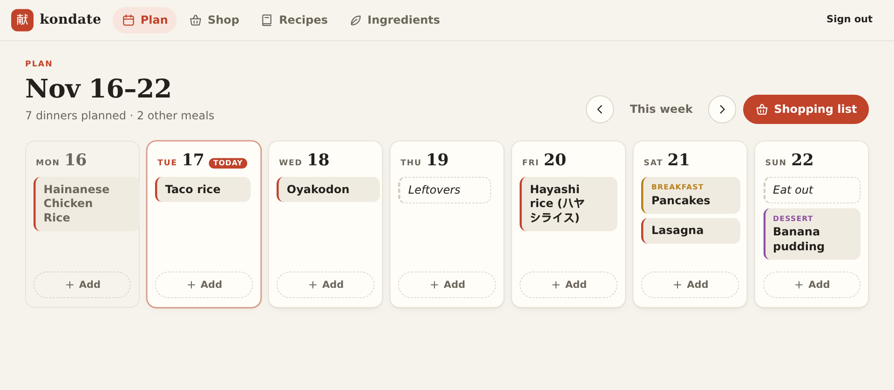
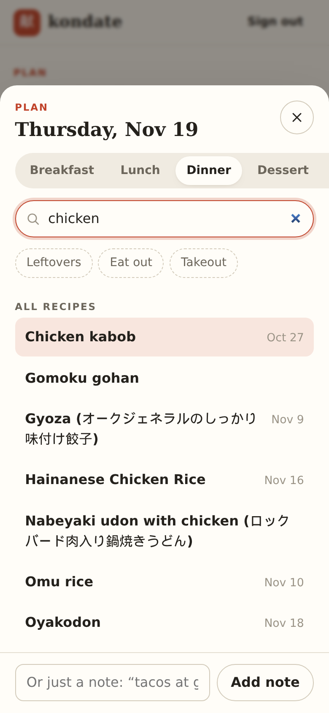
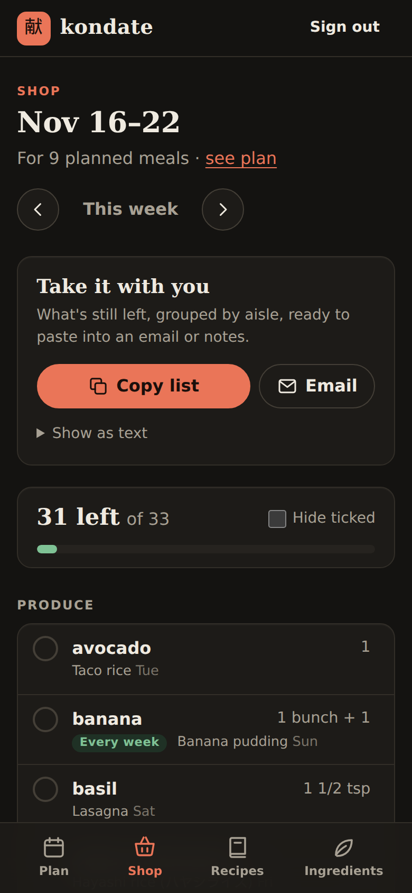
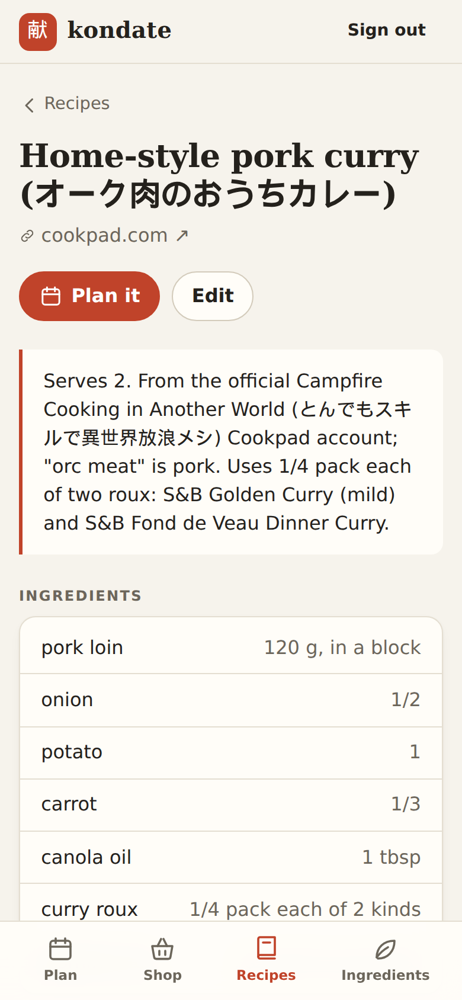
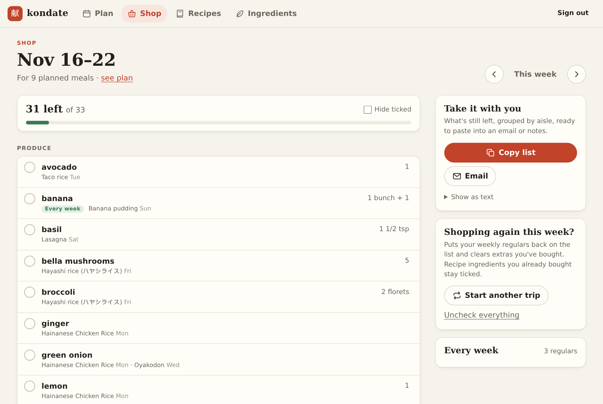

# kondate (献立)

*Kondate* is Japanese for "menu" or "meal plan". This is a small web app my family uses every day to plan the week's meals and do the shopping. It's built in Django with server-rendered pages, works well on a phone, and stays deliberately small.



<p align="center">
  
  
  
</p>

## What it does

- **Plan the week.** Seven days, dinner first. Tap **Add** on a day to pick a recipe by name or ingredient, choose from "haven't had in a while" suggestions, or just write a note ("leftovers", "eat out"). Breakfast, lunch, dessert and snack slots are there when needed, and last week's plan can be copied into an empty week.
- **Get the shopping list for free.** It's built from the week's meals plus the household's **weekly regulars** (milk, eggs…). Ingredients are merged across recipes, amounts in the same unit are added up (`1/2 cup` + `1 1/2 cups` = `2 cups`), and items are grouped by aisle in the order you walk the store. Tick things off on your phone in the store, or copy, email or share the list as plain text. **Start another trip** puts the regulars back on for a second shop. Things you usually have (salt, oil…) go in a collapsed "check the pantry first" section instead of the main list.
- **Keep recipes.** Each recipe has a name, link, notes, and ingredients with free-text amounts. Ingredient names autocomplete, and new ones are created as you type.
- **Teach it how you shop.** Each ingredient has an aisle and a buying habit: *when a recipe needs it*, *every week*, or *usually have it*.



One deployment serves one household: everyone who can sign in shares the same plan and recipes. It ships with 45 seed recipes, including 12 from the official [Campfire Cooking in Another World Cookpad account](https://cookpad.com/jp/users/114280341), with ingredient names translated so they merge with the rest on the shopping list.

## Engineering notes

Things that might interest a reader of the code:

- **Shopping list in a fixed number of queries.** `kondate/planning.py` builds the whole list for a week in five queries, however many meals and ingredients there are. Tests pin the query counts so an N+1 can't creep back in.
- **Adding up hand-typed amounts.** `kondate/quantities.py` adds free-text amounts only when it's safe: same unit (plurals folded together), exact fractions, Unicode `½` understood, and ranges such as `2-3` or `8 to 12` left alone. It never converts units or guesses; anything it can't add is listed as typed (`2 tsp + 1 tbsp + pinch`).
- **Works without JavaScript.** Every action is a plain form `POST`. One small script (`kondate/static/kondate/js/app.js`) adds the quick-plan sheet, filtering as you type, and ticking items without reloading the page. There's no build step and no framework.
- **Locked-down by default.** Every page requires sign-in (Django's `LoginRequiredMiddleware`). Sign-in is rate-limited with django-axes. A strict Content-Security-Policy (`mysite/middleware.py`) allows no inline script or style, and a test fails if a template adds one. Production settings pass `manage.py check --deploy` with no warnings.
- **Migrations you can deploy without downtime.** Schema changes follow expand → contract (for example, migration `0003` adds a column with a database default, and `0006` drops the old one in a later release), so the old and new code can run side by side during a deploy. CI checks that the migrations match the models, applies them on Postgres, rolls them back, and applies them again.
- **Tests.** pytest-django, run in CI against Postgres 17: views, permissions, query counts, migrations, and the quantity parser.

## Stack

Django 5.2 LTS · Python 3.13 · server-rendered templates · one hand-written stylesheet (light and dark themes) · SQLite locally, Postgres in production · gunicorn + whitenoise · pytest-django · GitHub Actions.

## Run it locally

```bash
uv venv .venv && uv pip install -p .venv -r requirements-dev.txt   # or python -m venv + pip
export DJANGO_DEBUG=1
.venv/bin/python manage.py migrate            # creates the tables and loads the seed recipes
.venv/bin/python manage.py createsuperuser
.venv/bin/python manage.py runserver
```

Open http://localhost:8000 and sign in. Add more household members at `/admin/`.

Run the tests with:

```bash
DJANGO_DEBUG=1 .venv/bin/python -m pytest
```

## Deploy your own

The repo includes a Render blueprint (`render.yaml`) and is set up for a free Render web service with a free Supabase Postgres database. **[docs/DEPLOY.md](docs/DEPLOY.md)** has the step-by-step setup, the settings reference, notes on running it, and troubleshooting.

## Layout

```
kondate/
  models.py      Ingredient, Recipe, RecipeIngredient, Meal, ShoppingCheck, ShoppingExtra
  planning.py    week arithmetic, shopping-list aggregation, plain-text export
  quantities.py  adding up free-text amounts
  views.py       function views; every write is a POST
  seed/          recipe data loaded by data migrations
  static/        styles.css and app.js
  tests/         pytest-django suite
mysite/          settings, URLs, CSP middleware
render.yaml      Render blueprint
docs/            deployment guide and screenshots
```

## License

[GPL-3.0](LICENSE)
